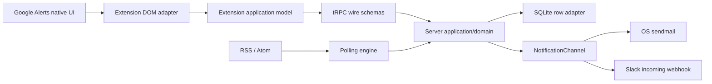

# Architecture and deliberate limits

## Product boundary

Signalpost turns a user's Google Alerts RSS catalog into routed
notifications. Google owns search configuration and upstream publication.
The extension imports source configuration; it does not impersonate a
supported Google Alerts CRUD API. Source ingestion and notification
channels are adapters, so this choice does not dictate future sources.

Models are explicit boundaries: transport DTOs encode timestamps as ISO
strings; domain objects use Dates and meaningful types; SQLite rows use
storage column names and integer timestamps. The extension maps wire data
into its own view/domain model. The contracts package shares the transport
contract only. No database row is a UI model.

## Synchronization and identity

A synchronization replaces the complete catalog for the authenticated user
and bound Google Alerts source. Stable feed IDs retain destinations,
routes and delivery history. Omitted feeds stop being active, and pending
deliveries are cancelled. This is PUT-style replacement implemented as a
tRPC mutation, not a client patch protocol.

An incomplete, signed-out or unrecognized page cannot replace the catalog.
A visible show-all control requires expansion first. Source IDs are inferred
from RSS URLs; they prevent accidental cross-account replacement but are
not cryptographic evidence of feed ownership. App authentication uses
Better Auth's Google OIDC login independently of the Google Alerts tab.

A single extension serializes writes and coalesces queued snapshots.
Across multiple browsers/devices, the last complete write wins; there is
no distributed edit conflict UI in this pilot.

## Delivery semantics

The first successful fetch establishes a baseline without sending existing
entries. Subsequent unseen entries get one delivery record per selected,
enabled destination. Entry identity uses provider IDs, falling back to the
article URL. SQLite uniqueness, transactions and persisted attempt state
support restart recovery without an external queue service.

The worker uses bounded concurrent polling and delivery. Defaults are a
60-second feed interval, 10-second network timeout, 2 MiB feed limit, and
bounded per-tick batches. Failures back off. Google may publish an alert
much later than the event itself; this is near-real-time polling of the
published feed, not guaranteed breaking-news latency.

The durable state table serves as a local outbox. A temporary delivery
lease is recovered after a crash. If the destination accepts a message and
the process dies before recording acceptance, retry can duplicate it.
Delivery is at-least-once within the retry policy, not exactly-once.
Transient failures retry up to eight attempts; permanent failures stop
immediately. Failed deliveries require administrator retry.
Only pending/failed work can be retried; removed routes cannot be revived
by pressing Retry. Disabling a feed/destination pauses eligible work.

Slack acceptance means a successful webhook HTTP response. Sendmail
acceptance means the local process accepted submission; it does not prove
inbox arrival. Neither transport's secret is returned by a query DTO.

## Authentication and operation

Better Auth core and its bundled OSS bearer plugin run on this server.
Google tokens are encrypted by Better Auth. Extension sign-in uses a
short-lived one-use authorization code bound to a PKCE verifier and an
exact allowlisted Chrome callback, then exchanges it for a bearer session.
The extension keeps the token in trusted extension storage, outside content
scripts. Unfinished sign-ins expire or invalidate on server restart.

The API enforces ownership on every user operation. Administrator status
comes from a server-configured allowlist of verified Google email addresses;
showing an admin tab is not an authorization control.

SQLite and in-process login state imply one server process. Use HTTPS when
remote, a protected data directory, a trusted local mail transport, backups
and a process supervisor. Horizontal replicas, high availability, tenant
quotas and indefinite history retention are not implemented promises.

## Tests and scope decisions

Deterministic unit tests exercise domain rules, boundary parsing, ownership,
auth handoff, DOM state and retry behavior. A small child-process probe
kills the delivery process and checks persistent recovery. It does not need
external credentials or send real notifications. Broad system automation
and live mutation of dependency files were deliberately omitted. Deploy a
locked dependency change as a restartable release instead.

Twilio could be evaluated later as an additional channel adapter for SMS
and other messaging channels. It is not a dependency of this pilot; assess
its current pricing, availability and fit when that feature is requested.

## Deployment boundary

A validated deployment intent maps to the existing environment-variable
contract and then to a Pulumi component with Docker and Kubernetes adapters.
The domain, API, SQLite and UI models are unchanged. One OCI runtime uses
persistent storage, non-root execution and a sendmail-compatible OS utility.
Provider resources stay in `src/infrastructure`; no cloud SDK enters the
application. See [deployment](deployment.md) for the supported targets,
single-writer constraints and verified/unverified environment boundary.
